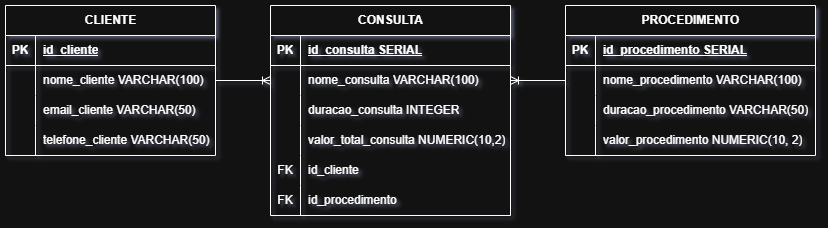

tem como objetivo o desenvolvimento de um sistema de software para a Clínica Sorriso Metálico, gerenciar os agendamentos de pacientes e histórico de atendimentos, substituindo a papelada do dia a dia. O sistema registrará nome, CPF do paciente e escolha do dentista, permitirá anotações de procedimentos pelos profissionais, e terá identidade visual nas cores azul marinho e prata com foco em alta performance e resposta rápida, conforme os requisitos elicitados.

**CLIENTE:** 1 cliente para N consultas (1:N).\
**CONSULTA:** N consultas para 1 procedimento (1:N).
